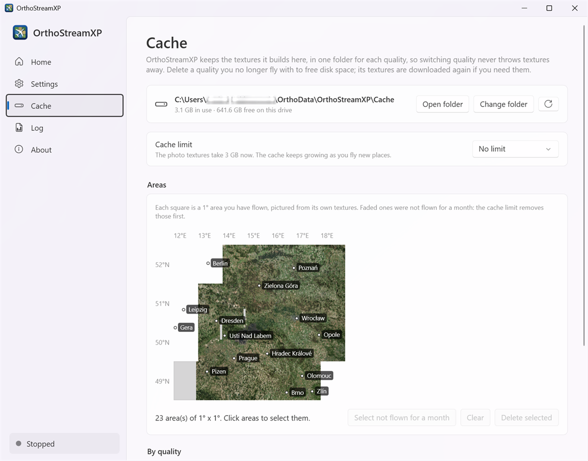
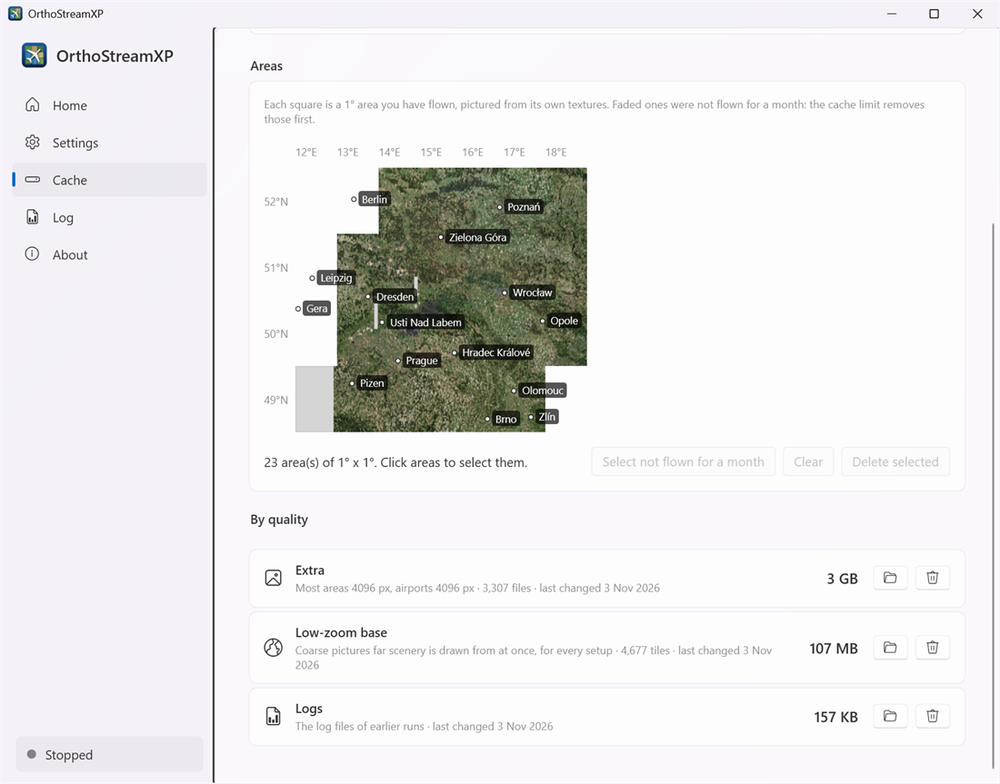

# Cache

[User guide](README.md) › Cache

The cache holds the pictures OrthoStreamXP downloads and the textures it builds. Areas you have flown before load from the cache at once, without the internet. Anything you delete is downloaded again the next time you fly there.

## Folder and limit

- The top card shows the cache folder, how much it uses and the free space on that drive.
  - **Open folder** opens the cache folder in Explorer.
  - **Change folder** chooses another cache folder.
  - The round arrow refreshes the figures.
- **Cache limit** caps the space the textures may take: *No limit*, 25 GB, 50 GB, 100 GB, 200 GB, 500 GB or 1 TB. When the cache grows past the limit, OrthoStreamXP deletes the areas you flew longest ago first.

## Areas

The map shows each 1° × 1° area you have flown, pictured from its own textures. Faded squares were not flown for a month; the cache limit removes those first.

To free space by hand:

1. Click the areas you want to remove, or click **Select not flown for a month**.
2. Click **Delete selected**. OrthoStreamXP shows how much space the selected areas take and asks you to confirm. The textures are deleted in every quality. **Clear** empties the selection.

Areas can be deleted only while OrthoStreamXP is stopped, because X-Plane may be reading them.

## By quality

Each quality preset keeps its textures in its own folder, so switching presets never throws textures away. This list shows how much each one takes:

- **One row per preset you have flown with** (for example *Extra*), with its texture sizes and number of files. The preset you use now is marked **In use**. Delete a preset you no longer use to free its space.
- **Low-zoom base:** coarse pictures that distant scenery is drawn from. All presets share it. If you delete it, distant scenery is a plain colour at the start of a flight until these pictures are downloaded again.
- **Logs:** the log files of earlier runs.
- A folder left by an older version of OrthoStreamXP, from before each preset had its own folder, is listed too. OrthoStreamXP no longer uses it, so you can delete it.

Each row has a folder button that opens it in Explorer and a bin button that deletes it after you confirm.

Next: [Troubleshooting](troubleshooting.md)
