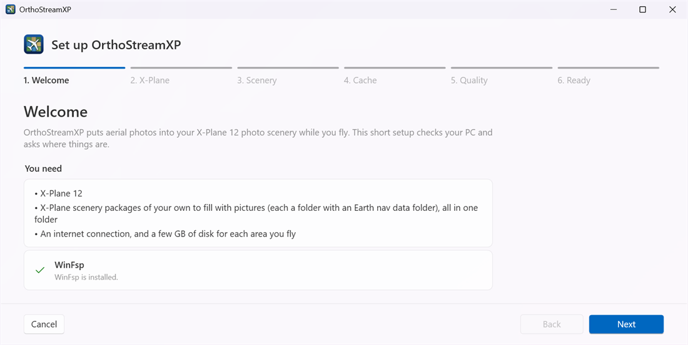
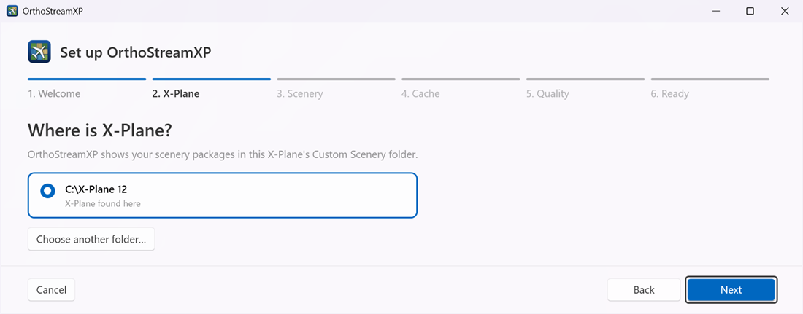
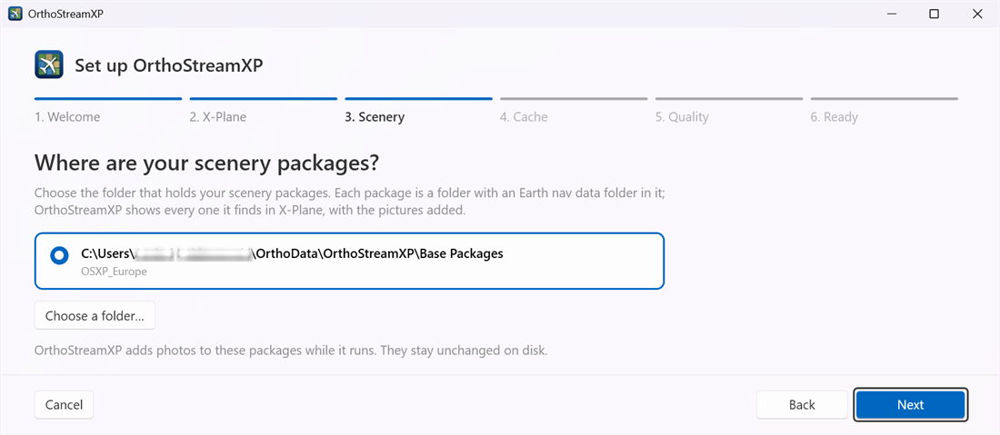
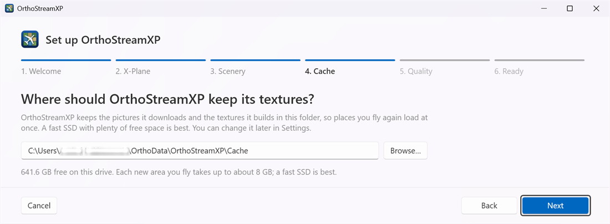
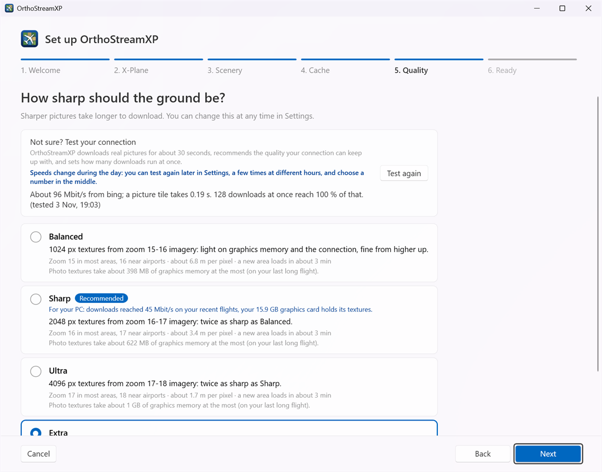
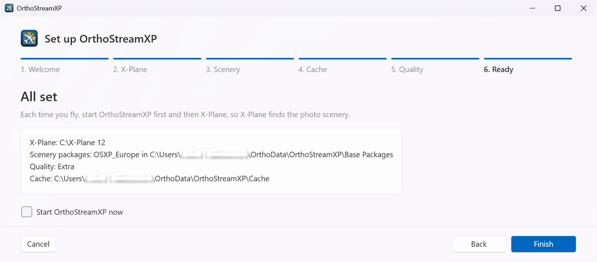

# First setup

[User guide](README.md) › First setup

The setup opens the first time you start OrthoStreamXP. It has six steps and takes a minute or two. Use **Next** and **Back** to move between the steps; nothing is saved until you click **Finish**.

You can run it again later from **Settings › Run the setup again**. A second run starts from your current settings, and **Cancel** leaves them unchanged.

## 1. Welcome



This step lists what you need and checks for WinFsp.

- A green tick with **WinFsp is installed** means you can continue.
- If WinFsp is missing, click **Get WinFsp** and install it. Then restart your computer and open OrthoStreamXP again: WinFsp works only after a restart.

## 2. X-Plane



OrthoStreamXP looks for X-Plane 12 on your PC and offers every installation it finds. Pick the one you fly with.

If yours is not listed, click **Choose another folder…** and choose the folder that contains `X-Plane.exe`. That folder must also have a `Custom Scenery` folder.

## 3. Scenery



Click **Choose a folder…** and pick the **parent folder** that holds your scenery packages, not one of the packages. Below the folder, OrthoStreamXP lists the packages it found.

In the example below you have to choose the "OrthoPackages" folder.

  ```
  D:\OrthoPackages\
      Europe\
          Earth nav data\
          terrain\
          ...
      Asia\
          Earth nav data\
          ...
  ```

- Your packages stay unchanged on disk. While OrthoStreamXP runs, they appear in X-Plane's `Custom Scenery` folder with the photos added. When it stops, they disappear from there again.
- If the folder has no packages, the hint turns red: *That folder has no scenery packages*. Check that each package has an `Earth nav data` folder inside it.
- If X-Plane's `Custom Scenery` already contains a folder with the same name as one of your packages, you get a warning. Usually another streaming tool still shows that package there; close that tool before you start OrthoStreamXP.

## 4. Cache



This is where OrthoStreamXP keeps the pictures it downloads and the textures it builds, so areas you fly again load at once.

- Click **Browse…** or type a full path, such as `D:\OrthoStreamXP\Cache`.
- Choose a folder on a fast SSD with plenty of free space. The page shows how much space is free on that drive. Each new 1° × 1° area takes up to about 2 GB at Balanced, 8 GB at Sharp and 30 GB at Ultra or Extra.
- You can change the folder or set a size limit later on the [Cache page](cache.md).

## 5. Quality



Pick how sharp the ground should be: **Balanced**, **Sharp**, **Ultra** or **Extra**. Each card shows the texture size, the imagery zoom level, the metres per pixel, and roughly how long a new area takes to load. See [Settings › Quality](settings.md#quality) for a comparison.

**Not sure?** Click **Test my connection** (it says **Test again** if you have tested before). OrthoStreamXP downloads real pictures for about 30 seconds, then:

- marks the quality your connection can keep up with as **Recommended**, and selects it for you;
- sets how many downloads run at once.

Internet speed changes during the day, so you can repeat the test later in [Settings › Pictures and download](settings.md#pictures-and-download).

## 6. Ready



This step summarises your choices: the X-Plane folder, the scenery packages, the quality and the cache folder. Tick **Start OrthoStreamXP now** if you want to fly straight away, then click **Finish**.

Next: [Flying](flying.md)
