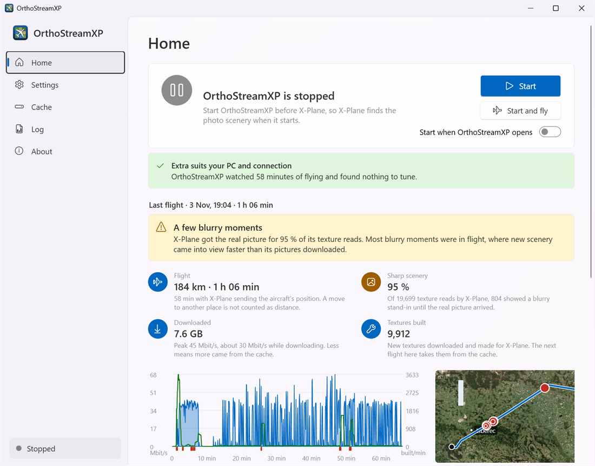

# Flying

[User guide](README.md) › Flying

## The start order

X-Plane looks for scenery only when it starts, so **OrthoStreamXP must be running before X-Plane starts**.

The Home page has two ways to start:

| Button | What it does |
|---|---|
| **Start and fly** | Starts OrthoStreamXP, waits until the scenery is ready, then starts X-Plane for you. This is the easiest option. While OrthoStreamXP runs, the button reads **Start X-Plane**. |
| **Start** | Starts only OrthoStreamXP. Start X-Plane yourself afterwards. |

Turn on **Start when OrthoStreamXP opens** if you want the scenery to start every time you open the app.

If X-Plane was already running when you started OrthoStreamXP, Home shows **Restart X-Plane**. Quit X-Plane and start it again to see the photos.

## The Home page

Before your first start, Home shows **How it works**: start OrthoStreamXP, start X-Plane, fly.

From top to bottom:

- **Status card.** Shows whether OrthoStreamXP is stopped, starting, ready (*Photo scenery is ready*) or in use (*Flying with photo scenery*). The **Start** button becomes **Stop** while it runs. The dot at the bottom of the sidebar shows the same state on every page.
- **Notices.** Tuning suggestions, updates and problems appear here, each with a button for the next step.
- **Last flight.** A report on your most recent flight, shown while OrthoStreamXP is stopped (see below).
- **Session figures** (*This session* while it runs, *Last session* after it stops): how many textures X-Plane got, how many of its reads got the real picture, how many textures are being built now, and the download speed or the number of picture tiles downloaded.
- **X-Plane.** *Waiting for X-Plane* until X-Plane sends the aircraft position, then *Connected* with the aircraft's position and speed. *Paused or in the menu* means X-Plane has stopped sending it for now. There is nothing to set up in X-Plane: OrthoStreamXP finds it on the same PC by itself.
- **Quality.** Your current preset, with a **Change quality** link.
- **Scenery packages.** The packages shown in X-Plane while OrthoStreamXP runs.

## During the flight

- **Load your flight as usual.** OrthoStreamXP builds the textures X-Plane asks for, and follows your aircraft to build the scenery ahead of it.
- **A new area takes a few minutes the first time.** Until its pictures arrive, X-Plane briefly shows a blurrier version of the ground. The next time you fly there, the area comes straight from the cache.
- **Sharper presets take longer.** The quality cards in Settings show roughly how long a new area takes to load.
- **Stopping.** When you finish flying, quit X-Plane first, then click **Stop** in OrthoStreamXP. OrthoStreamXP finishes the textures it is building and removes the photo scenery from X-Plane. If you close the window while OrthoStreamXP runs, it asks first, because X-Plane would lose the photo scenery.

## After the flight: the flight report

When OrthoStreamXP stops, Home shows a report of the flight. It starts with a verdict:

- **Smooth flight:** the scenery was sharp, or nearly so.
- **A few blurry moments** or **Often blurry**, with when they happened. Blurry moments at the start come from X-Plane loading the area and clear as soon as the pictures arrive. Blurry moments in flight mean new scenery came into view faster than its pictures downloaded; if that happens often in one place, a lower quality or the tuning suggestions may help.

Then the figures:

- **Flight:** distance and duration. Only the time X-Plane sent the aircraft's position counts, and moving the aircraft to another place is not counted as distance.
- **Sharp scenery:** the share of X-Plane's texture reads that got the real picture straight away. Lower values mean more blurry moments.
- **Downloaded:** data downloaded and the peak speed. Less data means more came from the cache.
- **Textures built:** new textures made for X-Plane during this flight.
- **A chart** of download speed and textures built over time, with blurry moments marked in red.
- **A map** of your route, with the places where the scenery was blurry.

## Tuning suggestions

After a flight of **10 minutes or more**, OrthoStreamXP checks how the scenery kept up on your PC and connection.

- If your preset suits your setup, Home says so, for example *Extra suits your PC and connection*.
- If changes would help, Home shows **Tuning for <preset> from your last flight**. It lists each suggested change and why it would help. Click **Apply** to accept the changes or **No, thanks** to ignore them. Nothing changes without your OK.
- After a shorter flight, Home shows *Fly a little longer for tuning*.

You can undo the tuning at any time in [Settings › Tuning](settings.md#tuning).

Next: [Settings](settings.md)
