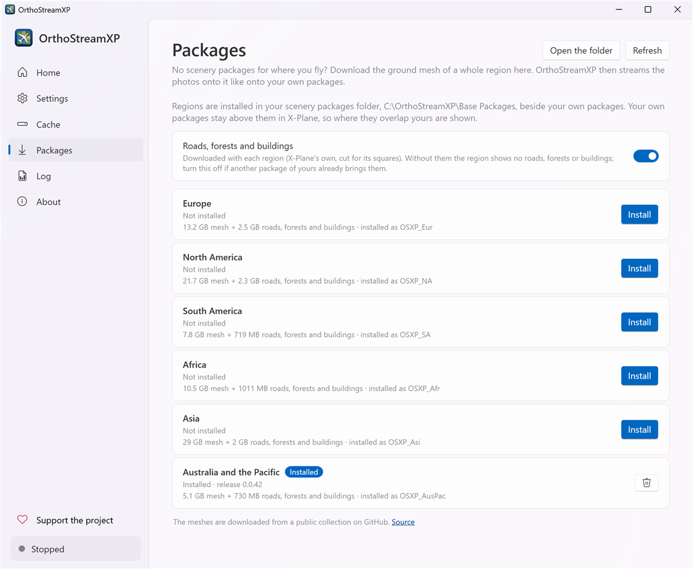
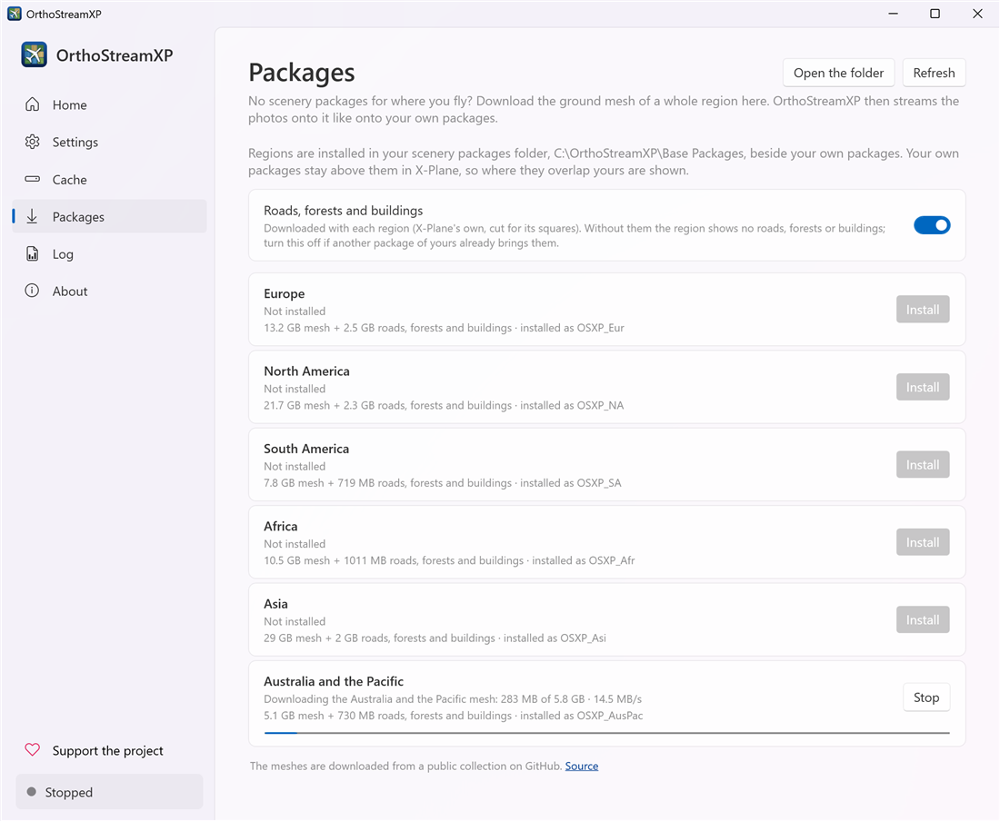

# Packages

[User guide](README.md) › Packages

OrthoStreamXP streams photos onto scenery packages: the ground's shape (the mesh) for each area. The quickest way to get them is to download the mesh of a whole region, on the **Packages** page or in the **Scenery packages** step of the setup. You can also use packages of your own; keep them in a folder of their own (see [One folder per source](#one-folder-per-source)).



The meshes are downloaded from a public collection on [GitHub](https://github.com/kubilus1/autoortho-scenery). Six regions are offered:

| Region | Package | Download (with roads, forests and buildings) |
|---|---|---|
| Europe | `OrthoStream_Eur` | about 16 GB |
| North America | `OrthoStream_NA` | about 25 GB |
| South America | `OrthoStream_SA` | about 9 GB |
| Africa | `OrthoStream_Afr` | about 12 GB |
| Asia | `OrthoStream_Asi` | about 33 GB |
| Australia and the Pacific | `OrthoStream_AusPac` | about 6 GB |

The page shows the exact sizes of the current release.

## Where they go

Each region is installed as a package of its own in the **scenery packages folder** chosen in [Settings › Folders](settings.md#folders). If you download one during the setup and have not chosen a folder yet, it goes to `OrthoStreamXP\Base Packages` in your user folder, and that folder becomes your scenery packages folder.

Leave about 1.7 times the download size free on the drive: the files take more room once they are unpacked.

## One folder per source

Keep the downloaded regions in a folder of their own, and the packages of each other tool (Ortho4XP, OrthoStudio XP, XPME, AutoOrtho) in theirs. For example:

```
D:\Scenery\OrthoStream\    <- the regions downloaded in OrthoStreamXP
D:\Scenery\Ortho4XP\       <- your Ortho4XP tiles
D:\Scenery\OrthoStudio\    <- your OrthoStudio XP packages
```

Why:

- **No doubled scenery.** A downloaded region covers a whole continent. Packages from two sources for the same area bring two meshes, and often two sets of roads, forests and buildings, which can show twice.
- **Each tool keeps its own folder.** Ortho4XP, OrthoStudio XP and the others update and delete their packages in their folders. Mixed with packages from elsewhere, it is easy to delete or overwrite the wrong one, and hard to tell which tool a package (and a problem with it) comes from.
- **Easy to switch.** To fly with another source, choose its folder in [Settings › Folders](settings.md#folders), with the scenery stopped. Your packages stay as they are, and each keeps its textures in the cache.

OrthoStreamXP uses one scenery packages folder at a time, so you fly with one source at a time.

The **Packages** page installs into the folder chosen at that moment, shown at the top of the page. Before you download a region, check that it is your folder for downloaded regions, not your own packages' folder. Don't have one yet? Choose a new, empty folder in [Settings › Folders](settings.md#folders), then install. Home warns that no scenery packages were found until the first region is in it.

## Roads, forests and buildings

A square of a downloaded mesh no longer shows X-Plane's own roads, forests and buildings. **Roads, forests and buildings** downloads them with each region, into one shared package, `OrthoStream_Overlays`. Turn it off if another package of yours already brings them. The choice applies to the next region you install or update.

## Downloading, stopping and resuming



- **Install** starts the download. While one region downloads, the others wait: one install runs at a time. The progress and speed show under the region.
- **Stop** stops it. What was downloaded is kept: **Resume** continues from there, even after OrthoStreamXP was closed.
- A region is used from OrthoStreamXP's next start, and never half-installed: it appears in your packages folder only when all of it is there.
- When a newer release comes out, the region says **Update available**. Updating downloads it again in full.
- **Delete** removes the region and its roads, forests and buildings. Another region's stay.

You can install a new region while OrthoStreamXP runs. Updating or deleting a region needs OrthoStreamXP stopped, because X-Plane has its files open while it runs.
