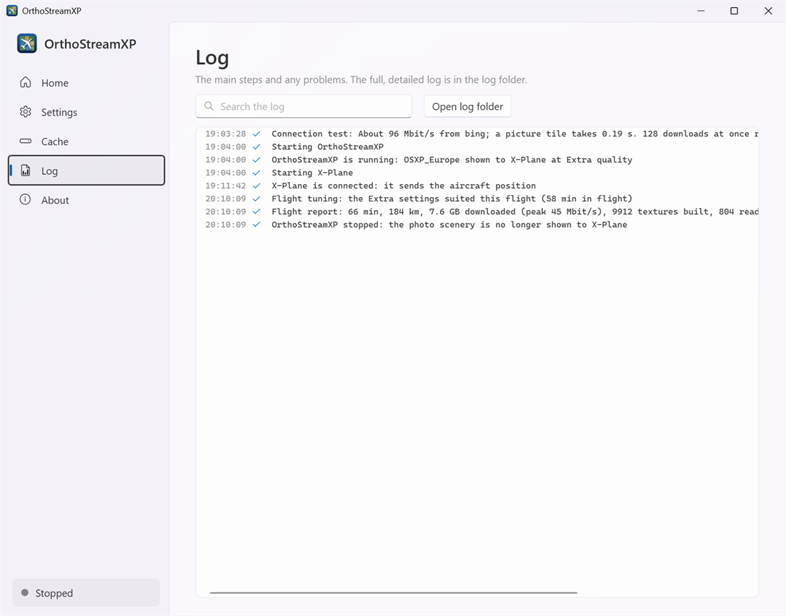
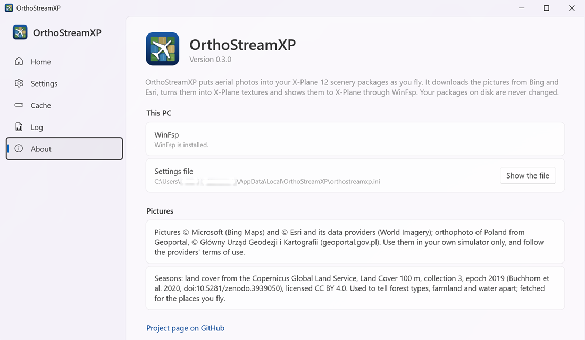

# Troubleshooting

[User guide](README.md) › Troubleshooting

When something goes wrong, Home shows a notice that says what happened, usually with a button for the fix.

## Common problems

| Notice or symptom | What to do |
|---|---|
| **No photos in X-Plane** | Make sure OrthoStreamXP was running **before** X-Plane started. If Home says **Restart X-Plane**, quit X-Plane and start it again. |
| **WinFsp is needed** / **WinFsp could not show the scenery** | Click **Get WinFsp**, install (or repair) WinFsp, restart your computer, then click **Start** again. If you installed WinFsp or OrthoStreamXP and have not restarted Windows since, restart it first. |
| **A scenery folder is in the way** | X-Plane's `Custom Scenery` folder already has a folder with the same name as one of your packages. Usually another streaming tool still shows it there: close that tool before you start OrthoStreamXP and check your scenery_packs.ini file and click **Start** again. If it is a real folder, move or rename it. **Open Custom Scenery** opens the folder. |
| **Your scenery packages were not found** | The packages folder is missing or empty. Click **Open settings** and choose the parent folder that holds your packages |
| **X-Plane was not found** | The X-Plane folder has no `Custom Scenery` folder. Choose the folder X-Plane is installed in. |
| **A folder cannot be written** | Choose a cache folder you can write to, for example one in your user folder. |
| **A setting needs attention** | A value in the settings file is not valid. The notice names it; click **Open settings** to fix it. |
| **Setup is not finished** | Click **Run setup**. |
| **X-Plane could not be started** | **Start and fly** could not start X-Plane. The photo scenery is ready: start X-Plane yourself. |
| **Restart OrthoStreamXP to use your new settings** | The settings file changed while OrthoStreamXP was running. Click **Restart now** to use the new values. |
| **Downloads are failing** | Check your internet connection. OrthoStreamXP keeps trying; **Open log** shows the details. |
| **Blurry ground for a while** | A new area takes a few minutes the first time. If it happens often, try a lower preset or apply the tuning suggestions after your flight (see [Flying](flying.md#tuning-suggestions)). |
| **Patchy colours between photos** | Turn on **Even out the colours between photos** in [Settings › Colours](settings.md#colours). |
| **Photos look too bright next to X-Plane's own scenery** | Lower **Exposure** in [Settings › Colours](settings.md#exposure). |

## The Log page

The Log page lists the main steps and any problems of this session. Type in **Search the log** to filter the list. **Open log folder** opens the full, detailed logs in `%LOCALAPPDATA%\OrthoStreamXP\logs`.

## The About page

The About page shows your version, whether WinFsp is installed (with a **Get WinFsp** button if it is not), where the settings file is, the imagery credits, and a link to the project page on GitHub.

## Updates

OrthoStreamXP checks for updates when it opens and from time to time while it runs, and downloads a new version in the background. When the update is ready, Home shows **OrthoStreamXP x.y.z is ready to install**. If the scenery is streaming, finish your flight and stop it first; then click **Update and restart**. Your settings, cache and flight history stay.

## Uninstalling

Use **Windows Settings › Apps**. OrthoStreamXP asks whether to delete your settings and downloaded scenery as well. If you answer **No**, they stay for a later install.

## Reporting a bug

Open an issue on the project's [GitHub page](https://github.com/flysimdev/OrthoStreamXP/issues) and include:

- **What happened:** what you saw, and what you expected instead.
- **Steps to reproduce:** what you did before the problem appeared, for example the area you were flying over and your quality preset.
- **Your system:** OrthoStreamXP version (on the About page), Windows version and graphics card.
- **The session log:** the log file of that session, from `%LOCALAPPDATA%\OrthoStreamXP\logs`.

Next: [Questions and answers](faq.md)
